# itinereX

Builds a cleaned, analyzable road network graph from the itiner-E road dataset originally introduced by de Soto et al. (2025) [here](https://www.nature.com/articles/s41597-025-06140-z).

The goal of this repository is to take the source linework (often with near-miss junctions, duplicate endpoints, and degree-2 chains), rebuild a consistent topology, and export a weighted NetworkX graph that can be used for downstream analysis (routing, centrality, “important nodes”, etc.).

This paper is organized around two questions, both posed on the network
built from the Itiner-e Roman road data:

1. **Can hierarchical agglomerative clustering (HAC) on travel-time distances identify spatial units that emerge from the road network itself?**

   We use percolation-equivalent HAC to cluster the network at every travel-time threshold, calibrate the approach against a known partition, and then apply it to our own network to see what clusters it produces on its own terms.

2. **Are the spatial units that emerge significant, or are they artefacts of the network's own construction?**

   A cluster can look like a coherent region without reflecting anything beyond the geometry and density of the digitized road network it was built from. Answering this requires comparing the clusters obtained on the real network against the same procedure run on spatial and temporal null models of that network—i.e., networks that share its nodes and broad connectivity but not whatever structure actually produces the clustering.
   

## What this repo produces

- An interactive **before/after** visualization of the network cleaning.
- A cleaned, noded topology with degree-2 simplification.
- A **time-weighted** graph export where each edge has `weight = time_s` (seconds) plus stable `node_id` / `edge_id` mappings.

## Repository structure

```
data_cleaning/     Raw Itiner-e linework + the scripts that clean it into a weighted graph
  raw/               Raw inputs (itinere_roads.*, route-segments-all-*.ndjson)
  scripts/           itinerex_clean_network.py, export_geojson.py
  cleaned_data/      Cleaned/derived outputs (G_clean_weighted_*, province_subnetworks.pkl, rrn_*.geojson, ...)
src/                 General analysis scripts (centrality, pagerank) that read cleaned_data/
results/
  HAC/               Hierarchical agglomerative clustering + travel-time percolation analysis
  Null-models/       Spatial null models (KNN/Delaunay/MST) for the road network, adapted from
                     github.com/hayaalmuhanna/Roman-Provinces-ECI (CC BY-SA 4.0)
reference/           Source papers, province boundaries, and bibliography used across analyses
notebooks/           Exploratory notebooks
maps/                Map outputs, incl. the GitHub Pages site (index.html + schematics)
paper/               Draft manuscript (results/HAC, targeting Royal Society Open Science)
```

See `results/HAC/README.md` and `results/Null-models/README.md` for those analyses specifically.

## Cleaning schematic


## Interactive map
Open the hosted map on GitHub Pages:

[](https://nk173.github.io/itinereX/roads_after_cleaning.html)

- Map: https://nk173.github.io/itinereX/roads_after_cleaning.html

## Roman Provinces

The notebook also overlays Roman provinces (from `reference/provinces/provinces.shp`) onto the cleaned network and partitions the graph into per-province sub-networks.

**How sub-networks are constructed**
- **Edge → province assignment:** each edge is assigned to the (most specific) province containing its midpoint; if the midpoint is not inside any polygon, the edge is assigned to the province with the longest overlap length.
- **Crossing edges (excluded):** an edge is marked as crossing if its start/end points fall in different provinces.
- **Outside edges (excluded):** an edge is outside if it cannot be assigned by midpoint or overlap fallback.
- **Per-province subgraph:** for each province, we filter `G_clean` to edges assigned to that province and build a subgraph from the incident nodes.

**Interactive province map**

[](https://nk173.github.io/itinereX/roads_with_provinces_nodes.html)

- Map: https://nk173.github.io/itinereX/roads_with_provinces_nodes.html

**Province-related outputs** (in `data_cleaning/cleaned_data/`)
- [G_clean_weighted_edges_with_province.csv](data_cleaning/cleaned_data/G_clean_weighted_edges_with_province.csv): weighted edge list with `time_s` and province assignment (plus crossing/outside flags)
- [crossing_edges.geojson](data_cleaning/cleaned_data/crossing_edges.geojson): edges whose endpoints fall in different provinces
- [outside_provinces_edges.geojson](data_cleaning/cleaned_data/outside_provinces_edges.geojson): edges not assignable to any province
- [province_subnetworks.pkl](data_cleaning/cleaned_data/province_subnetworks.pkl): per-province NetworkX subgraphs + edge tables

## Network statistics

| Metric | Value |
|---|---:|
| nodes | 8460 |
| edges | 12849 |
| avg_degree | 3.0375886524822695 |
| avg_weighted_degree (sum of `weight` per node) | 167930.63592041272 (in seconds)|
| connected_components | 12 |
| largest_component_nodes | 7612 |
| largest_component_edges | 11693 |
| largest_component_fraction_of_nodes | 0.8997635933806146 |


## How to run

1. Open the notebook: [notebooks/itinere-X_network.ipynb](notebooks/itinere-X_network.ipynb)
2. Run the cells top-to-bottom (from the `notebooks/` directory; paths are relative to repo root via `../`).

Outputs:
- `maps/roads_before_cleaning.html`
- `maps/roads_after_cleaning.html`
- `data_cleaning/cleaned_data/G_clean_weighted_with_ids.pkl`

## HAC Percolation
## Why

The main repo builds its own cleaned network from the raw Itiner-e linework with a
flat 2 km/h travel-time model. To make the HAC / percolation results directly
comparable to (and citable alongside) the manuscript, this folder rebuilds the
graph the way the manuscript does and re-runs the same method on top.

| | main repo (`../src`) | here (`network0-average`) |
|---|---|---|
| Network | own cleaning of raw Itiner-e (8,460 n / 12,849 e / 12 comp) | manuscript's Itiner-e export, endpoint-noded (10,506 n / 14,770 e / 13 comp) |
| Travel time | flat 2 km/h on Mercator planar length | **Tobler's hiking function** on `Avg_Slope`, `LENGTH_GEO` (geodesic) |
| Europe↔Asia | none | Bosporus + Dardanelles ferry links (already in the export) |
| Provinces | `provinces/provinces.shp` | AWMC "Roman Empire AD 200" (+ regiones), from the cloned repo |
| Method | HAC per component → threshold sweep → percolation curve / ARI | *identical* |

## Contents

```
roman-road-networks/      git clone of github.com/MatteoMazzamurro/roman-road-networks (untouched)
src/build_network.py      raw shapefile -> network_paper.pkl / .gpkg
src/hac_percolation.py    HAC + threshold sweep + percolation curve + province ARI/NMI + bootstrap CI
data/                     build + analysis outputs (git-ignored large files)
maps/                     figures
```

## Environment

Runs under the `MIR` conda env (geopandas 1.1.3, networkx 3.4.2, scipy, scikit-learn):

```
/Users/nk821/opt/anaconda3/envs/MIR/bin/python network0-average/src/build_network.py
/Users/nk821/opt/anaconda3/envs/MIR/bin/python network0-average/src/hac_percolation.py
```

`build_network.py` runs in seconds. `hac_percolation.py` takes ~10–15 min (the
all-pairs travel-time distance matrix for the 9,132-node continental component
plus the bootstrap over merge-height thresholds).

## Travel-time model (matches `network-analysis.Rmd`)

```
slope  = Avg_Slope / 100                       # segment mean slope, fraction
pace   = 0.6 * exp(3.5 * |slope + 0.05|)        # seconds per metre (Tobler)
time_s = LENGTH_GEO * pace                      # LENGTH_GEO = geodesic length, m
```

## Network reconciliation

| | manuscript | this build |
|---|--:|--:|
| segments (edges) | 14,901 | 14,770 |
| nodes | 10,516 | 10,506 |
| connected components | 13 | 13 |
| giant component | Europe–Asia–Africa | 9,132 nodes, lon [−9.4, 41.6], lat [22.7, 52.2] |

Deltas: 2 zero-length segments dropped; ~129 parallel segments between the same
node pair collapsed to the fastest one (HAC uses shortest-path distance, so this
is lossless for the analysis). Endpoint snapping at 1 cm (EPSG:3395).

## Headline results (average linkage, Tobler travel time)

- **Critical threshold** (steepest log–log collapse in cluster count) ≈ **14 h**.
- **Scaling law** `S_max ∝ t^0.96` (95% CI [0.92, 1.00], R² 0.98) over the 6 h–4000 h
  regime, fitted with equal weight per log-decade — the largest travel-time cluster
  grows ~linearly with the tolerated trip length. (An earlier `t^1.15` was an OLS
  artefact of merge-height density at low t; `plot_combined.py`'s log-grid gives 0.93.)
- **Emergent regions vs. Roman provinces** (Adjusted Rand Index / NMI vs. AWMC AD 200,
  10,430 nodes with a known province):

  | snapshot | clusters | ARI | NMI |
  |---|--:|--:|--:|
  | 24 h | 514 | 0.20 | 0.73 |
  | 2 d  | 154 | 0.52 | 0.80 |
  | 7 d  | 22  | 0.49 | 0.78 |

  Exhaustive search over every merge height peaks sharply at **≈ 77 h ≈ 3.2 days**,
  **ARI 0.70** (bootstrap 95% CI on ARI [0.68, 0.71]; the best-threshold estimate is
  a hard peak — every bootstrap resample selects the same 77 h merge height).
- Interpretation: at a ~3-day travel-time budget the road network's spontaneous
  regions align strongly with the imperial provincial map — a quantitative handle
  on the manuscript's argument that road-system planning operated at the provincial
  level, and the starting point for the resilience / targeted-attack analysis the
  manuscript flags but does not perform.

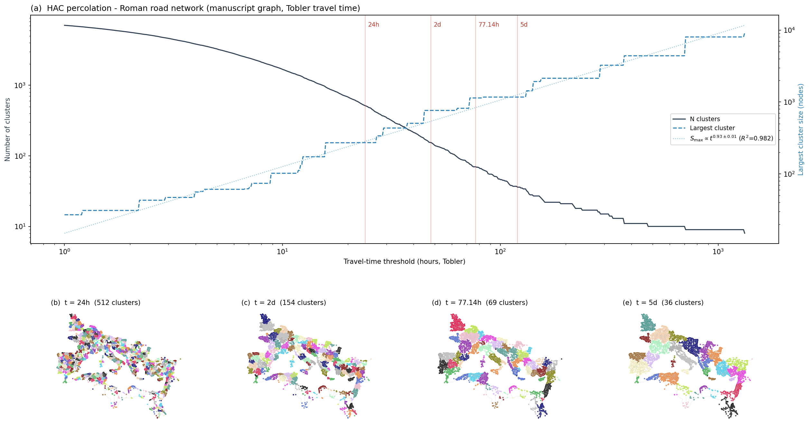
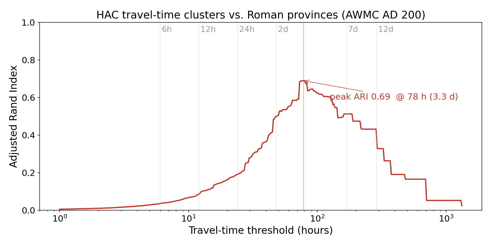
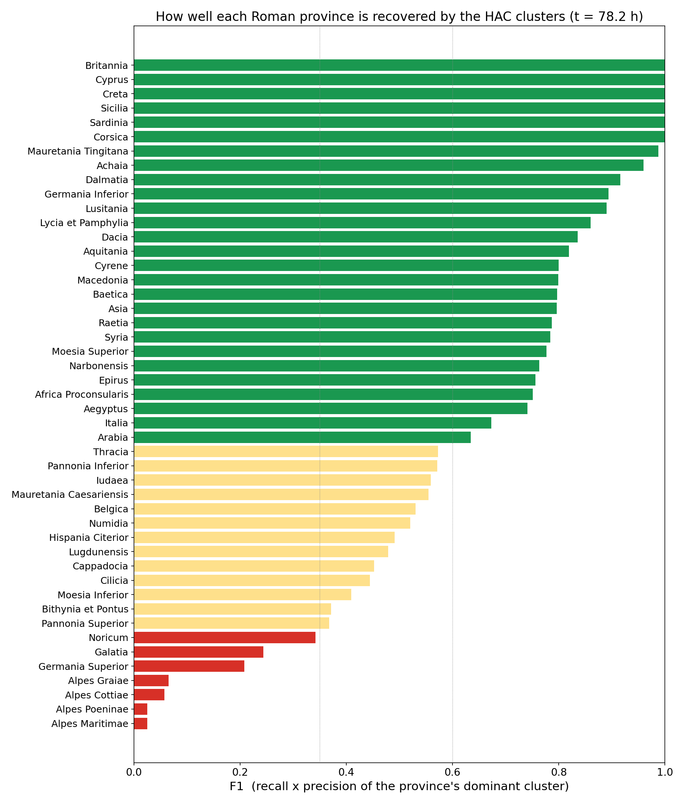


## Spatial Null Models

To benchmark the empirical Roman road network against geography-constrained counterfactuals, this repository also generates four spatial null families:

- **Global KNN+MST**: Whole-network k-nearest-neighbor graph with a minimum spanning tree backbone
- **Global Delaunay+MST**: Whole-network Delaunay triangulation with MST backbone and distance trimming
- **Province-Bridged KNN+MST**: Per-province KNN subnetworks joined by empirically allowed inter-province bridges
- **Province-Bridged Delaunay+MST**: Per-province Delaunay subnetworks joined by empirically allowed inter-province bridges

All nulls preserve the empirical geography of the Roman world while altering local wiring rules. Sea-crossing artifacts are masked using empirical province-pair adjacency. Full construction details are documented in [NULL_MODEL_GENERATION_METHODOLOGY.md](NULL_MODEL_GENERATION_METHODOLOGY.md).

### Null Model Network Maps

<table>
  <tr>
    <td align="center">
      <strong>Empirical network reference</strong><br>
      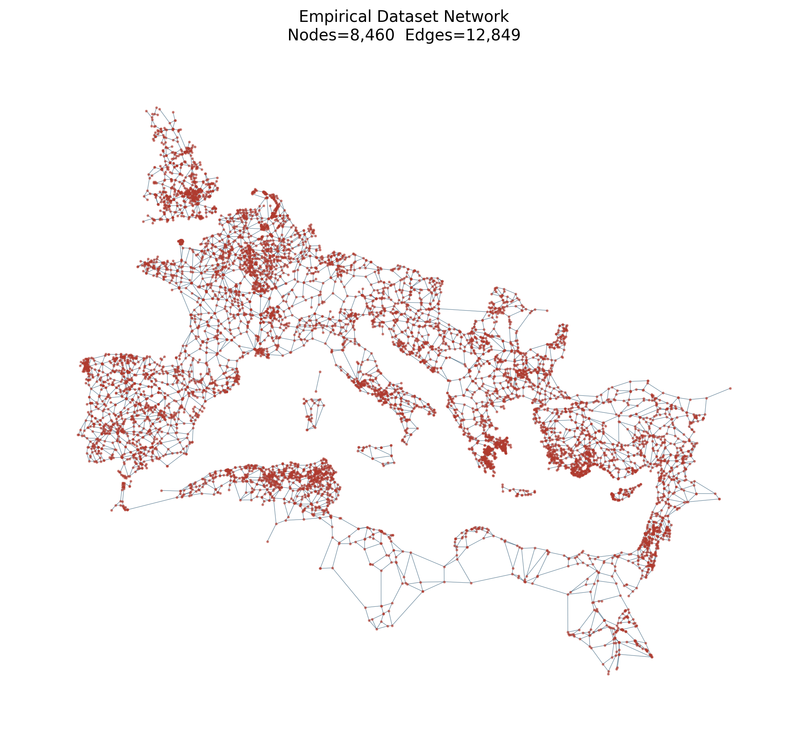
    </td>
    <td align="center">
      <strong>Global KNN+MST null</strong><br>
      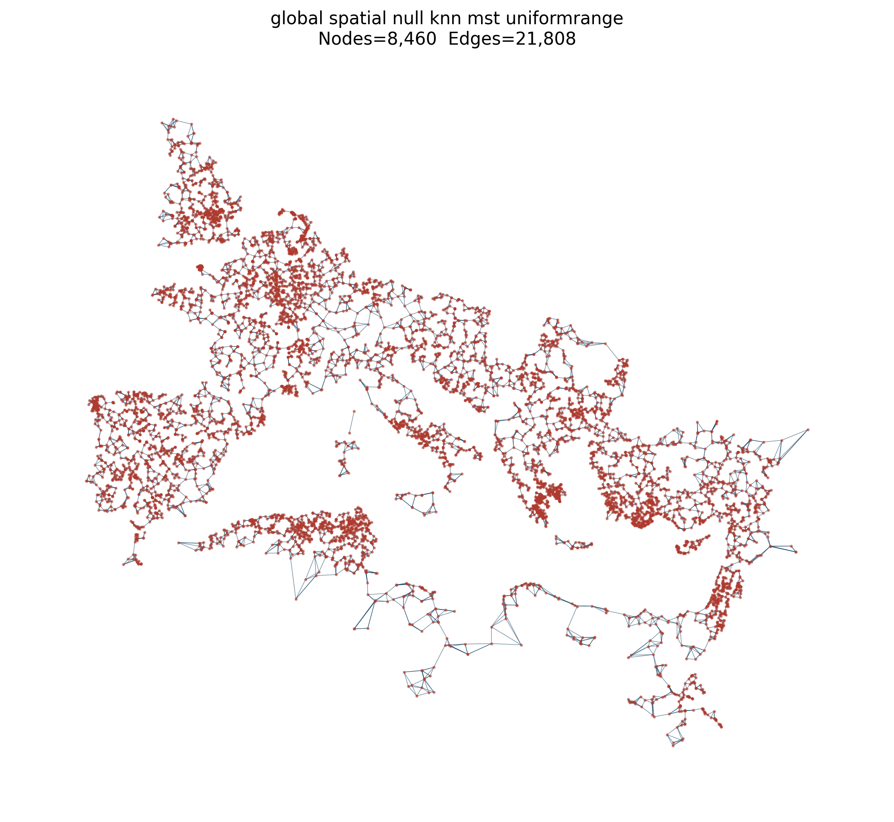
    </td>
  </tr>
  <tr>
    <td align="center">
      <strong>Global Delaunay+MST null</strong><br>
      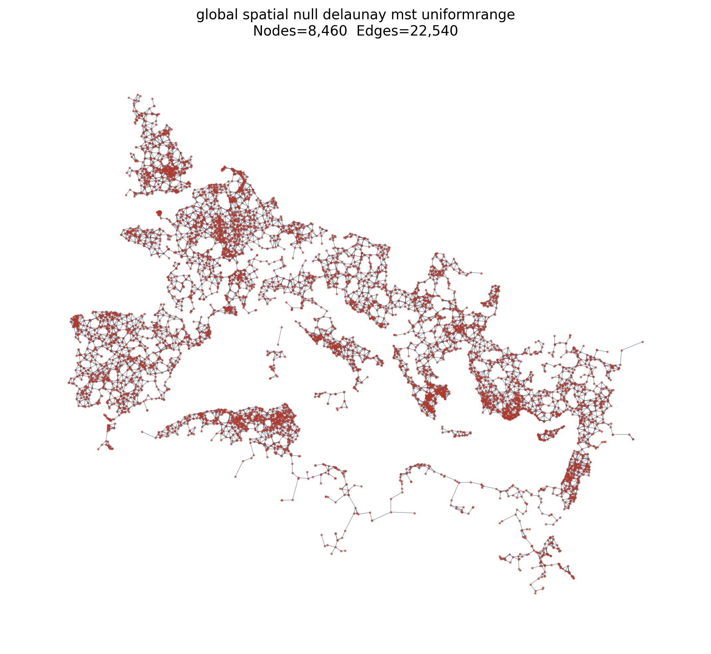
    </td>
    <td align="center">
      <strong>Province-Bridged KNN+MST null</strong><br>
      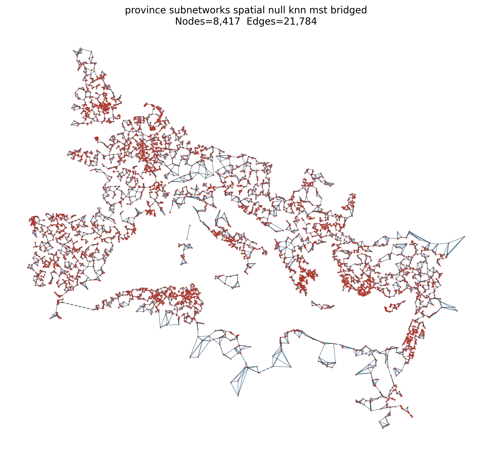
    </td>
  </tr>
  <tr>
    <td align="center" colspan="2">
      <strong>Province-Bridged Delaunay+MST null</strong><br>
      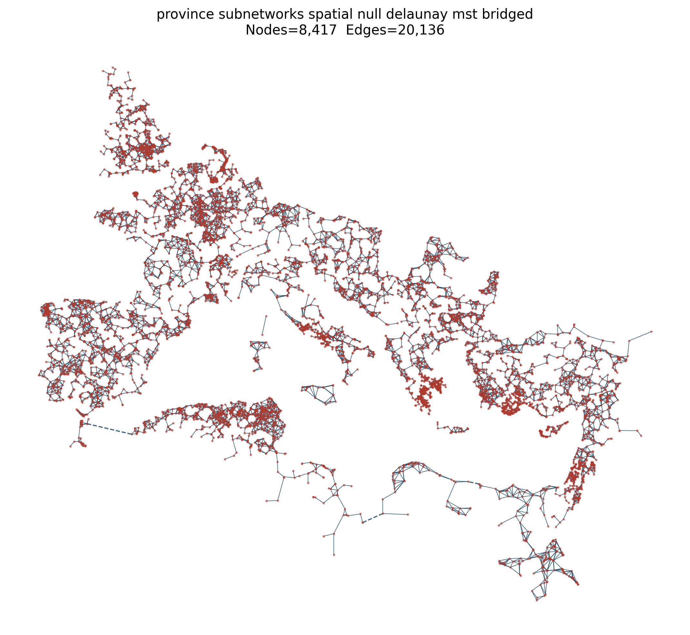
    </td>
  </tr>
</table>

These maps make the comparison intuitive: the nulls retain the same large-scale provincial footprint as the empirical network, but differ in how they densify local neighborhoods and how bridges emerge between provincial subnetworks.

### Empirical Scaling Exponents

Using the current itinereX empirical road graph (`empirical_00`), the refreshed scaling fit results are:

| Cost Type | Model | Exponent | R² | AIC |
|----------|-------|----------|----|-----|
| Distance | Power law | 0.251238 | 0.4660 | -7.31 |
| Distance | Exponential | 5.98218e-06 | 0.9749 | -28.70 |
| Cost | Power law | 0.550548 | 0.3578 | 5.52 |
| Cost | Exponential | 1.40782e-05 | 0.8946 | -7.13 |

The refreshed empirical-only output is saved in `data/processed/null_pipeline/scaling/empirical_decay_fit_results_current.csv`. In this rerun, the **exponential form fits the empirical Roman network better than the power-law form** for both distance- and cost-based decay.

### HAC Percolation Figures

The null graphs were also passed through hierarchical agglomerative clustering / percolation diagnostics to show how connectivity consolidates as the travel-time threshold increases.

For the empirical itinereX HAC figure, the scaling relation is a different quantity: it fits **largest cluster size** against threshold, `S_max ~ t^alpha`, over the `6-4000` hour range. Recomputed from the current empirical HAC cache, the updated value is:

- **Empirical HAC alpha**: `0.9068`
- **95% CI**: `[0.9018, 0.9118]`
- **R^2**: `0.9623`

This matches the exponent used in `itinereX/maps/hac_percolation_combined.pdf` and is distinct from the edge-decay exponents listed above. The refreshed result is saved in `data/processed/hac_empirical_scaling_alpha_current.csv`.

Applying the same `S_max ~ t^alpha` fit to the current null-model HAC results gives:

| Null Model | HAC alpha | 95% CI | R^2 |
|-----------|-----------|--------|-----|
| Global KNN+MST | 0.7614 | [0.7567, 0.7662] | 0.9249 |
| Global Delaunay+MST | 0.9112 | [0.9055, 0.9168] | 0.9253 |
| Province-Bridged KNN+MST | 1.0087 | [1.0044, 1.0130] | 0.9673 |
| Province-Bridged Delaunay+MST | 1.0145 | [1.0107, 1.0183] | 0.9743 |

These refreshed null-model HAC scaling fits are saved in `data/processed/hac_null_scaling_alpha_current.csv`.

<table>
  <tr>
    <td align="center">
      <strong>Global KNN+MST null percolation</strong><br>
      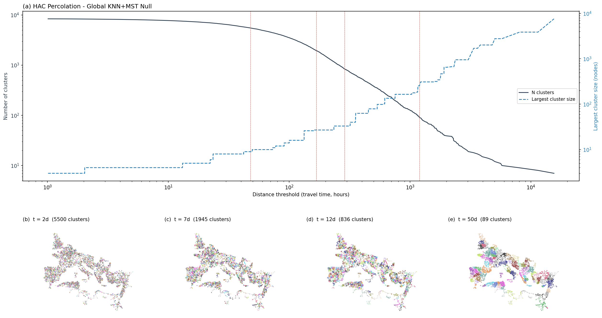
    </td>
    <td align="center">
      <strong>Global Delaunay+MST null percolation</strong><br>
      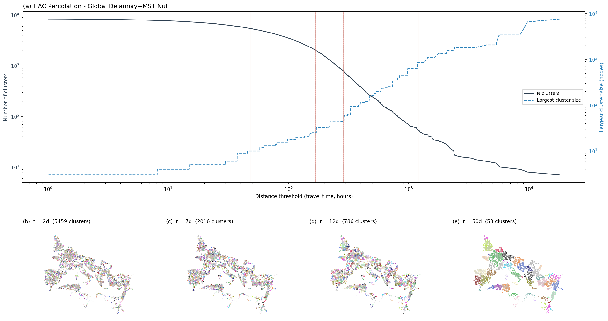
    </td>
  </tr>
  <tr>
    <td align="center">
      <strong>Province-Bridged KNN+MST null percolation</strong><br>
      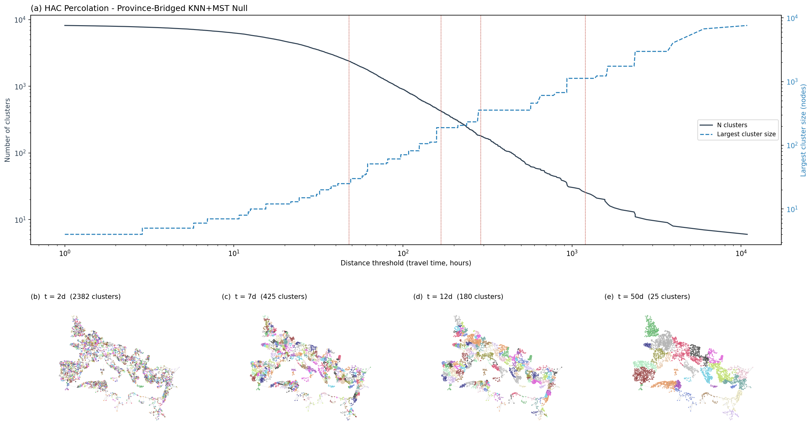
    </td>
    <td align="center">
      <strong>Province-Bridged Delaunay+MST null percolation</strong><br>
      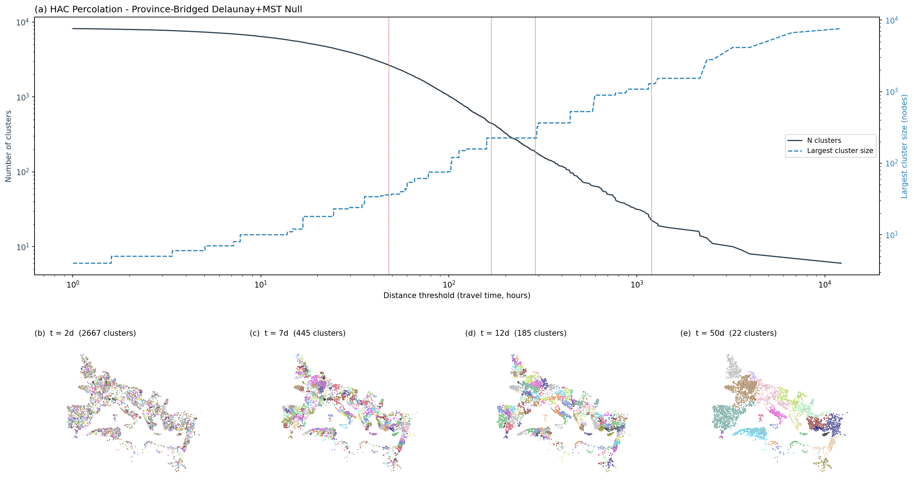
    </td>
  </tr>
</table>


## To Do
1. **Road network metrics and economic complexity**
   - Compare road network metrics against updated and improved economic complexity indicators to investigate potential relationships between infrastructure organisation and economic development.

2. **Multiscale edge density in empirical and null networks**
   - The null models produce significantly more edges than the empirical network. Perform spatial node aggregation at progressively coarser scales (e.g., towns, cities, provinces) on both the empirical and null networks.
   - Compare the number of edges at each scale to identify where the excess connectivity in the null models originates. This will help determine whether the differences arise primarily from local, regional, or long-distance connections.

3. **Minimum triangle angles and road redundancy**
   - Examine the distribution of the smallest interior angles of triangles formed by roads in the empirical network.
   - Investigate whether there is a characteristic minimum angle below which an additional road becomes redundant. When two roads diverge at a very small angle, they may provide nearly identical connectivity, making the construction of both unnecessary.
   - This could help identify geometric constraints or implicit efficiency principles underlying Roman road construction.

4. **Entropy of cluster sizes**
   - Calculate the Shannon entropy of the cluster-size distribution across different HAC thresholds.
   - Identify the threshold at which entropy peaks and investigate whether this corresponds to a meaningful spatial scale or transition in the network's hierarchical organisation.
